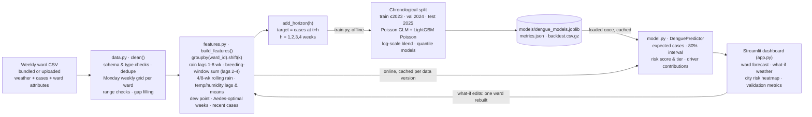

# Architecture: Dengue Early-Warning System

## 1. System data flow

**Offline** (`python train.py`, ~10 min CPU): clean → features → per-horizon training and validation → serialize.
**Online** (`streamlit run app.py`): load the models once → clean and featurize the data once per data version →
score only the ward-weeks shown on screen → explain. No network access is needed.

## 2. Lag pipeline (why these features)

Rain creates standing water; *Aedes aegypti* eggs need 7–14 days to become adults, and then viral incubation and
symptom onset follow. Rain therefore shows up in hospitals **2–4 weeks later**. For each forecast week *t*, and
**separately within each `ward_id`** (`groupby(...).shift(k)` / rolling windows), we compute:

* `rain_lag1…rain_lag8`, `rain_sum_lag2_4` (the breeding window), `rain_sum_4w`, `rain_sum_8w`, `heavy_rain_weeks_4w`
* `temp_lag1…4`, `temp_mean_4w`, `aedes_optimal_weeks_4w` (25–32 °C), `temp_range_c`
* `hum_lag1…4`, `hum_mean_4w`, `humid_weeks_4w` (>80%), `dew_point_c`
* surveillance: cases now, lags 1–3, 4-week mean, 2-week trend, city mean, same week last year
* ward vulnerability: `log_pop_density`, `water_logging_risk_index`, `sanitation_score`, `vulnerability_index = waterlog × (1 − sanitation)`
* seasonality: week-of-year sine and cosine

Every feature uses data from week *t* or earlier. `tests/test_pipeline.py` checks this: the lags match a manual
per-ward shift, no lag crosses from one ward into the next, and overwriting all future weeks does not change a
week's features.

## 3. Chronological validation split

Rows are split on the **target week**, never shuffled:

| Split | Target weeks | Used for |
|---|---|---|
| Train | 2016–2023 | fitting candidate models |
| Validation | 2024 | hyper-parameter search (20 LightGBM trials, 4 GLM penalties), early stopping, blend weight |
| Test | 2025 | scored **once**, after refitting the chosen setup on train + validation |

Random K-fold would leak information: neighbouring weeks are highly correlated, and lag features would put future
weather into training. Splitting by year also tests a full monsoon season that the model has never seen. Tier
thresholds come from 2016–2023 data only.

## 4. Model selection rationale

| Option | Verdict |
|---|---|
| Persistence (cases now) and seasonal naive (same week last year) | Baselines to beat |
| **Poisson GLM** (scaled features, L2 penalty) | Suits count data (log link, non-negative); stable and interpretable; strong at short horizons |
| **LightGBM, Poisson objective** | Captures non-linear weather thresholds and interactions (rain × water-logging, temperature optimum); best at 3–4 weeks |
| **Blend (chosen)** | `log ŷ = w·LightGBM + (1−w)·GLM`, with `w` tuned per horizon on 2024 (selected: 0.7 / 0.4 / 0.9 / 1.0 for 1/2/3/4 weeks). Both members are additive on the log scale, so the blend keeps **exact driver contributions**: exp(base + Σ contributions) = prediction. |
| LightGBM quantile (α = 0.1 / 0.9) | 80% prediction interval |
| Deep sequence models (LSTM etc.) | Rejected: 60 short weekly series, slower CPU inference, harder to explain to health officers |

**Results on the unseen 2025 test year** (model trained on 2016–2024):

| Horizon | MAE | RMSE | R² | RMSE persistence | RMSE seasonal naive | 80% coverage | Tier accuracy | Alert recall / precision |
|---|---|---|---|---|---|---|---|---|
| 1 wk | 1.00 | 2.04 | 0.73 | 2.90 | 3.01 | 81% | 84% | 73% / 73% |
| 2 wk | 1.05 | 2.18 | 0.69 | 3.43 | 3.01 | 75% | 84% | 69% / 73% |
| 3 wk | 1.07 | 2.12 | 0.71 | 3.81 | 3.01 | 75% | 82% | 73% / 67% |
| 4 wk | 1.30 | 2.28 | 0.67 | 4.00 | 3.01 | 83% | 82% | 76% / 60% |

The model cuts RMSE by 30–44% against persistence. About 99% of tier calls are within one tier of the actual.
The strongest drivers are weather: 4-week rainfall, dew point, humidity lags, temperature and seasonality.

**Risk tiers:** expected cases per ward per week, cut at the 70th/85th/95th percentiles of 2016–2023 ward-weeks:
Low < 2, Medium 2–7, High 7–13, Critical ≥ 13. The 0–100 risk score is piecewise linear, so each tier spans 25
points.

## 5. Compute and API cost controls

* **Zero external API and LLM calls.** All inference is local; there are no per-request costs, no API keys, and no
  LLM tokens are spent. If an LLM-written situation summary is added in the final round, it will be
  (a) generated only on a button press, (b) cached per ward-week-horizon, (c) given only the compact driver table
  (≈300 tokens) rather than raw data, and (d) limited by a `max_tokens` cap and a daily budget counter.
* **Serialized models** (`joblib`, compressed, 8 MB) are loaded once per server process with
  `st.cache_resource`. No training happens at app start.
* **Caching:** cleaning and the lag features are computed once per data version (`st.cache_data`, keyed by an MD5
  hash of the uploaded file). Predictions are computed only for the 26-week window on screen and cached per week
  (all 60 wards × 4 horizons in about 1 s).
* **Incremental what-if:** a weather edit rebuilds features for **one ward only** and re-scores 4 rows, in
  milliseconds.
* **Vectorized pandas and NumPy throughout**; no per-row Python loops in the pipeline.
* **Measured:** cold start ≈ 17 s (mostly the one-time model load); changing ward/horizon ≈ 1 s; changing the week
  ≈ 2 s. Laptop CPU; no GPU needed.
* **Ingestion:** new weeks arrive as a CSV upload or by appending to `data/dengue_weekly.csv`. A live weather feed
  would be pulled once per day in a batch job and cached locally, never on each page view.
