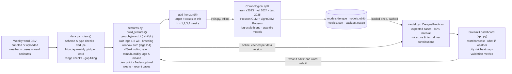
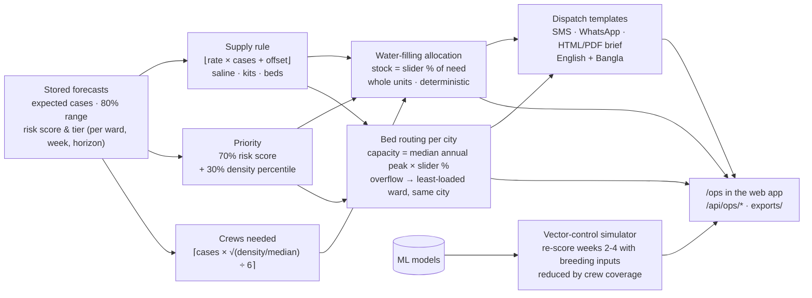

# Architecture: Dengue Early-Warning System

## 1. System data flow

**Offline** (`python train.py`, ~10 min CPU): clean → features → per-horizon training and validation → serialize.
**Online** (`streamlit run app.py`): load the models once → clean and featurize the data once per data version →
score only the ward-weeks shown on screen → explain. No network access is needed.

## 2. Lag pipeline (why these features)

Rain creates standing water; *Aedes aegypti* eggs need 7–14 days to become adults, and then viral incubation and
symptom onset follow. Rain therefore shows up in hospitals **2–4 weeks later**. For each forecast week *t*, and
**separately within each `ward_id`** (`groupby(...).shift(k)` / rolling windows), we compute:

* `rain_lag1…rain_lag8`, `rain_sum_lag2_4` (the breeding window), `rain_sum_4w`, `rain_sum_8w`, `heavy_rain_weeks_4w`
* `temp_lag1…4`, `temp_mean_4w`, `aedes_optimal_weeks_4w` (25–32 °C), `temp_range_c`
* `hum_lag1…4`, `hum_mean_4w`, `humid_weeks_4w` (>80%), `dew_point_c`
* surveillance: cases now, lags 1–3, 4-week mean, 2-week trend, city mean, same week last year
* ward vulnerability: `log_pop_density`, `water_logging_risk_index`, `sanitation_score`, `vulnerability_index = waterlog × (1 − sanitation)`
* seasonality: week-of-year sine and cosine

Every feature uses data from week *t* or earlier. `tests/test_pipeline.py` checks this: the lags match a manual
per-ward shift, no lag crosses from one ward into the next, and overwriting all future weeks does not change a
week's features.

## 3. Chronological validation split

Rows are split on the **target week**, never shuffled:

| Split | Target weeks | Used for |
|---|---|---|
| Train | 2016–2023 | fitting candidate models |
| Validation | 2024 | hyper-parameter search (20 LightGBM trials, 4 GLM penalties), early stopping, blend weight |
| Test | 2025 | scored **once**, after refitting the chosen setup on train + validation |

Random K-fold would leak information: neighbouring weeks are highly correlated, and lag features would put future
weather into training. Splitting by year also tests a full monsoon season that the model has never seen. Tier
thresholds come from 2016–2023 data only.

## 4. Model selection rationale

| Option | Verdict |
|---|---|
| Persistence (cases now) and seasonal naive (same week last year) | Baselines to beat |
| **Poisson GLM** (scaled features, L2 penalty) | Suits count data (log link, non-negative); stable and interpretable; strong at short horizons |
| **LightGBM, Poisson objective** | Captures non-linear weather thresholds and interactions (rain × water-logging, temperature optimum); best at 3–4 weeks |
| **Blend (chosen)** | `log ŷ = w·LightGBM + (1−w)·GLM`, with `w` tuned per horizon on 2024 (selected: 0.7 / 0.4 / 0.9 / 1.0 for 1/2/3/4 weeks). Both members are additive on the log scale, so the blend keeps **exact driver contributions**: exp(base + Σ contributions) = prediction. |
| LightGBM quantile (α = 0.1 / 0.9) | 80% prediction interval |
| Deep sequence models (LSTM etc.) | Rejected: 60 short weekly series, slower CPU inference, harder to explain to health officers |

**Results on the unseen 2025 test year** (model trained on 2016–2024):

| Horizon | MAE | RMSE | R² | RMSE persistence | RMSE seasonal naive | 80% coverage | Tier accuracy | Alert recall / precision |
|---|---|---|---|---|---|---|---|---|
| 1 wk | 1.00 | 2.04 | 0.73 | 2.90 | 3.01 | 81% | 84% | 73% / 73% |
| 2 wk | 1.05 | 2.18 | 0.69 | 3.43 | 3.01 | 75% | 84% | 69% / 73% |
| 3 wk | 1.07 | 2.12 | 0.71 | 3.81 | 3.01 | 75% | 82% | 73% / 67% |
| 4 wk | 1.30 | 2.28 | 0.67 | 4.00 | 3.01 | 83% | 82% | 76% / 60% |

The model cuts RMSE by 30–44% against persistence. About 99% of tier calls are within one tier of the actual.
The strongest drivers are weather: 4-week rainfall, dew point, humidity lags, temperature and seasonality.

**Risk tiers:** expected cases per ward per week, cut at the 70th/85th/95th percentiles of 2016–2023 ward-weeks:
Low < 2, Medium 2–7, High 7–13, Critical ≥ 13. The 0–100 risk score is piecewise linear, so each tier spans 25
points.

## 5. Compute and API cost controls

* **Zero external API and LLM calls.** All inference is local; there are no per-request costs, no API keys, and no
  LLM tokens are spent. The final round did not add an LLM: the Phase 2 dispatch notices are deterministic
  templates (section 6.5), so they work with no internet and always give the same text for the same plan.
* **Serialized models** (`joblib`, compressed, 8 MB) are loaded once per server process with
  `st.cache_resource`. No training happens at app start.
* **Caching:** cleaning and the lag features are computed once per data version (`st.cache_data`, keyed by an MD5
  hash of the uploaded file). Predictions are computed only for the 26-week window on screen and cached per week
  (all 60 wards × 4 horizons in about 1 s).
* **Incremental what-if:** a weather edit rebuilds features for **one ward only** and re-scores 4 rows, in
  milliseconds.
* **Vectorized pandas and NumPy throughout**; no per-row Python loops in the pipeline.
* **Measured:** cold start ≈ 17 s (mostly the one-time model load); changing ward/horizon ≈ 1 s; changing the week
  ≈ 2 s. Laptop CPU; no GPU needed.
* **Ingestion:** new weeks arrive as a CSV upload or by appending to `data/dengue_weekly.csv`. A live weather feed
  would be pulled once per day in a batch job and cached locally, never on each page view.

## 6. Phase 2: operations command

Phase 2 extends the forecaster into a resource-optimization, intervention-simulation and dispatch system. All of it
sits on top of the stored forecasts (section 1), so the operations pages, the dispatch notices and the rest of the app
always describe the same forecast.

### 6.1 Supplies from forecasts

The onsite dataset adds `saline_bags_needed`, `diagnostic_kits_needed` and `hospital_beds_required`. Each one is an
exact step function of the week's case count. We searched for `floor(rate × cases + offset)` and found constants that
reproduce **all 31,320 rows**:

| Supply | Rule |
|---|---|
| Saline bags | ⌊2.385 × cases + 0.49⌋ |
| Diagnostic kits | ⌊1.165 × cases + 0.445⌋ |
| Hospital beds | ⌊0.30 × cases + 0.45⌋ |

`tests/test_operations.py` checks the match row by row. The same rule is applied to the forecast, using either the
expected cases or the top of the 80% range ("likely-high case", the default, which is safer for ordering stock and
for beds). If an uploaded file lacks the supply columns, `data.clean()` fills them in from the rule.

### 6.2 Constrained allocation (requirement 1)

* **Stock:** the regional store holds *s*% (30–100%, one slider or one per supply) of the forecast need in the
  selected area.
* **Priority** (0–100) = 0.7 × model risk score + 0.3 × the ward's `population_density_sqkm` percentile. Dense
  wards spread dengue faster, and risk alone would ignore that.
* **Water-filling:** ward *i* gets `need_i × min(1, λ × (20 + priority_i))`, with λ found by bisection so the total
  equals the stock. The riskiest, densest wards are filled to 100% first; the rest share what is left in proportion
  to priority, and no ward drops to zero while stock remains. Whole units are handed out by largest remainder
  (ties: higher priority, then ward order), so the result is deterministic and sums exactly to the stock.
* **Crews:** need = ⌈expected cases × √(density ÷ median density) ÷ 6⌉ for Medium risk and above (1–6 per ward). The
  *Total spraying crews* slider is shared out by the same water-filling.
* **Deficit warnings:** any shortfall marks a ward *Short*. It becomes a **critical shortage** if the ward is High
  or Critical risk, or gets under half of any item. The alert strip and tables update on every slider move (the plan
  takes about 0.1 s).

### 6.3 Hospital surge and overflow routing (requirement 2)

* **Capacity:** the data has no bed counts, so each ward's dengue beds = the beds it needed in the busiest week of
  a typical year (the median of its 2016–2023 annual peaks; at least 2). A normal season fits; a sharp one overflows.
  The stock slider opens that share of beds.
* **Routing** (`operations.route_overflow`): each ward first fills its own beds. Overflow from the highest-priority
  ward is placed first, **one patient at a time**, in the ward of the **same city** with the lowest current occupancy
  (ties: lower priority, then ward id). Placing one at a time spreads the load instead of swamping one neighbour.
  Patients who fit nowhere in the city are the net deficit. Patients never cross city pools.
* **Outputs:** per ward: beds open, needed, net balance, sent, received, without a bed, occupancy. Per city: load
  before and after routing, transfers, without a bed, spare beds (headroom). A ward's *allocated beds* in the supply
  table = beds secured anywhere in its city, so modules 1 and 2 always agree.
* **Tested:** patients are conserved (local + sent + unplaced = demand), no ward goes over capacity, every transfer
  stays inside one city, and a sending ward picks the emptiest receiver.

### 6.4 Vector-control simulator (requirement 3)

* **Coverage:** *k* larvicide/fogging crews remove a share of a ward's breeding habitat:
  `0.6 × (1 − exp(−k ÷ (2 × √(density ÷ median))))`. Returns diminish, and dense wards need more crews.
* **Model-driven counterfactual:** the trained models for horizons 2, 3 and 4 are re-run with the ward's
  standing-water inputs (this week's and the last four weeks' rain, rain sums, heavy-rain weeks,
  `water_logging_risk_index`, `vulnerability_index`) scaled by (1 − coverage). Temperature, humidity, recent cases and
  season stay as recorded. Only weeks 2–4 count, because larvae need 1–2 weeks to become biting adults.
* We tested the obvious alternative of lowering the recent-case features (as a stand-in for fogging killing
  infected adults). The model's response there was weak and changed sign between wards, so we did not use it. The
  breeding-habitat inputs gave consistent reductions in every week we checked.
* For speed, the forecasts for 0–8 crews in every ward are computed once per forecast week (≈0.2 s) and cached. A
  running minimum makes sure an extra crew never raises the forecast.
* **ROI:** cases prevented over weeks 2–4 ÷ crews. Beds and saline saved come from the supply rule applied to the
  baseline and scenario cases. **Automatic placement** gives each crew to the ward with the largest marginal gain,
  which is optimal with diminishing returns. Tests check that it beats putting every crew in any single ward, that
  more crews never prevent fewer cases, and that zero crews reproduces the stored forecast.

### 6.5 Dispatch notices (requirement 4)

`backend/dispatch.py` fills fixed templates from the plan:

* **SMS:** English in GSM-7 within 160 characters (shorter forms replace longer ones until it fits); Bangla in UCS-2
  with the part count shown.
* **WhatsApp:** *bold* markup with risk, expected cases and range, allocated / required supplies, bed transfers,
  crews, a deficit alert and two actions.
* **Commissioner brief:** a self-contained, A4-printable HTML page (KPIs, city bed pools, transfers, deficit cards,
  the full ward table) that can be printed to PDF. `/api/ops/brief` serves it; `python -m backend.export_samples` also
  prints a PDF with headless Edge or Chrome if one is installed.

Samples for one scenario are in [`exports/`](exports/).

### 6.6 Offline resilience (requirement 5)

* There is **no LLM or external API in any code path**. Forecasting, allocation, routing, simulation and dispatch
  are local Python, and the notices are templates, so there is nothing that needs a fallback.
* `backend/offline.py` has a kill-switch that makes every outbound connection and DNS lookup fail.
  `/api/ops/selftest` (the **Offline check** tab) runs all five modules under it and reports timings.
  `tests/test_operations.py` also starts the whole backend under it.
* The browser talks only to the local Next.js server. The production build bundles its fonts. The only internet
  resource is the OpenStreetMap background, and when it fails the map offers its offline view. A banner appears
  whenever the browser goes offline.

### 6.7 Phase 2 API

| Endpoint | Purpose |
|---|---|
| `GET /api/ops/plan` | Allocation, crews, bed routing and deficits. Parameters: `origin, horizon, stock, crews, basis, city`, optional `saline_pct, kits_pct, beds_pct` |
| `POST /api/ops/simulate` | Vector-control counterfactual: `{origin, city, crews}` for automatic placement or `{deployments: {ward: crews}}` |
| `GET /api/ops/dispatch` | SMS and WhatsApp notices (`lang=en|bn`) for the same plan parameters |
| `GET /api/ops/brief` | Printable HTML commissioner brief |
| `GET /api/ops/selftest` | Offline self-test with outbound network blocked |

### 6.8 Assumptions to state at judging

* Bed capacity is inferred from history (section 6.3). With real bed counts, only `operations.bed_capacity` changes.
* Crew coverage (60% maximum, scale 2 crews at median density) is a planning assumption, not a measured efficacy.
  The model then decides how much that coverage changes cases.
* There are no ward coordinates, so routing prefers the least-loaded ward rather than the nearest. A distance
  matrix would slot into the receiver choice in `route_overflow`.

## 7. AI disclosure

We used **Claude Code** (Anthropic), an AI coding assistant, in both phases. It helped with data analysis, deriving
the supply rule from the onsite dataset, the pipeline and model code, the FastAPI backend, the Next.js app, the
Phase 2 allocation, routing, simulator, dispatch and offline modules, the tests, and these documents. The team
reviewed, ran and tested everything. The running system makes **no** AI or LLM calls.
