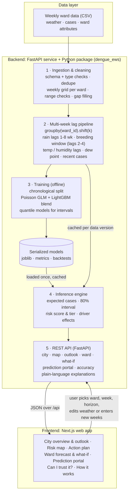

# 🦟 Dengue Early-Warning System

**Team CodeNova** · EDU AI Engineering Hackathon 2026 · Preliminary Round: *AI for Urban Dengue Outbreak*

Forecasts dengue outbreak risk for each city ward **2–4 weeks ahead** from weekly rainfall, temperature and
humidity. Public health officers can then send larvicide and spraying teams to the right wards *before* hospital
admissions peak.

    

---

## Contents

1. [The problem](#the-problem)
2. [What the system does](#what-the-system-does)
3. [System architecture](#system-architecture)
4. [Quick start](#quick-start)
5. [Using the dashboard](#using-the-dashboard)
6. [Model and validation](#model-and-validation)
7. [Cost and resource efficiency](#cost-and-resource-efficiency)
8. [Project structure](#project-structure)
9. [Team](#team)
10. [AI assistance and external services](#ai-assistance-and-external-services)

---

## The problem

Dengue does not follow the same day's weather. Rain leaves standing water, *Aedes aegypti* eggs take 7–14 days to
become adult mosquitoes, and then viral incubation and symptom onset follow. The result is a **2–4 week lag**
between rain and hospital spikes. The same rain also hits wards differently: poor drainage, crowding and weak waste
collection turn some wards into hotspots much faster than their neighbours.

## What the system does

| Requirement | How we meet it |
|---|---|
| **Weather data processing** | Ingests `avg_temp_c`, `rainfall_mm` and `relative_humidity_pct`, then computes **1–8 week rainfall lags**, the **2–4 week breeding-window rainfall** and rolling totals, separately for each `ward_id` |
| **Risk prediction engine** | Trained models forecast expected cases for **+1 to +4 weeks** with an 80% range, a 0–100 risk score and a **Low / Medium / High / Critical** tier for any ward and week |
| **Cost efficiency** | Local inference on serialized models loaded once, precomputed and cached forecasts, no paid API or LLM calls |
| **User interface** | Next.js web app: city overview and 4-week outlook, **interactive risk map**, ward forecast with **main weather drivers**, what-if scenarios, a prediction portal for new data, and an accuracy report |

---

## System architecture



### Components

| Layer | Component | Responsibility |
|---|---|---|
| Backend | `dengue_ews/data.py` | Validates and cleans raw weekly data, then aligns every ward to a complete Monday-weekly grid |
| Backend | `dengue_ews/features.py` | Ward-level multi-week weather lag pipeline; uses only data available on the forecast date |
| Backend | `train.py` | Trains one model per horizon, validates chronologically and serializes the models |
| Backend | `dengue_ews/model.py` | Loads the models once; returns predictions, intervals, risk tiers and driver breakdowns |
| Backend | `backend/main.py`, `backend/service.py` | FastAPI app: loads data and models once at startup, precomputes forecasts, serves the REST API |
| Backend | `backend/narrative.py` | Turns model output into plain-language headlines, reasons and suggested actions |
| Frontend | `frontend/` | Next.js 16 + React 19 + TypeScript + Tailwind; charts with Recharts, map with Leaflet |
| Frontend (alt.) | `app.py` | The original Streamlit dashboard, kept as a lightweight alternative |

### Request flow

1. The user picks a **ward**, a **forecast week** and an **early-warning window** (1–4 weeks) in the web app.
   The browser talks only to Next.js, which forwards `/api/*` requests to FastAPI.
2. The backend gets that ward's lag features (computed once at startup).
3. The models for the four horizons return expected cases, an 80% range and a tier.
4. **Drivers:** the ward is re-scored with each factor group (rainfall, temperature, humidity, recent cases, ward
   vulnerability) set to a typical value for that week of the year; the difference is shown as cases added or removed.
5. In **what-if** mode or the **prediction portal**, edited or new weather rebuilds the features for that single ward
   and re-scores it instantly.

Full design notes are in [ARCHITECTURE.md](ARCHITECTURE.md).

---

## Quick start

Requires **Python 3.11+**, **Node.js 20+** and git. Setup takes about 3–5 minutes.

```bash
git clone https://github.com/MLproject551/Hackathon_preli.git
cd Hackathon_preli
python -m venv .venv
# Windows:      .venv\Scripts\activate
# macOS/Linux:  source .venv/bin/activate
pip install -r requirements.txt
uvicorn backend.main:app --port 8000        # terminal 1: API (loads models once, ~15 s)
```

```bash
cd frontend && npm install && npm run dev    # terminal 2: web app
```

Open **http://localhost:3000**. The trained models are included in the repository, so no training step is needed.

The original Streamlit dashboard still works as a lightweight alternative: `streamlit run app.py` → http://localhost:8501.

| Optional command | Purpose |
|---|---|
| `python -m pytest -q` | Verifies the lag pipeline, guards against future-data leakage and checks inference |
| `python train.py` | Retrains and re-validates all models from the raw data (~10 min on a laptop CPU) |

---

## Using the web app

The **week slider** and the **"Warn me 1–4 weeks ahead"** switch at the top apply to every page.

| Page | What it shows |
|---|---|
| **City overview** | One-sentence summary, risk-level counts, a **4-week outlook per city**, ward cards ranked by risk, a week-by-week heatmap, CSV export |
| **Risk map** | Real OpenStreetMap map with every ward as a bubble coloured by risk (Critical wards pulse); hover, click, fly to a city, filter by level, **time-lapse** through the weeks. An **offline honeycomb view** works without internet |
| **Action plan** | Set how many field teams you have and get a ranked list of which wards each team should cover, with the suggested action; shows what changed since last week (new alerts, improvements, fastest risers); CSV and print |
| **Ward forecast** | Plain-language story, forecast cards for +1…+4 weeks, history and forecast chart, **driver breakdown**, weather with the breeding window, an action checklist, **what-if weather**, print / save as PDF |
| **Prediction portal** | The way to forecast **new weeks** beyond the dataset: enter (or upload as CSV) the latest weeks of rainfall, temperature, humidity and cases for a ward and get the next 4 weeks |
| **Can I trust it?** | Results on the unseen 2025 year in plain language, forecast-vs-actual chart for any ward, risk-level confusion matrix |
| **How it works** | The 2–4 week delay, the pipeline, the data split, the model, the architecture and the tech stack |

**Ward positions on the map are approximate:** the dataset has ward IDs but no boundaries or coordinates, so each
ward's bubble is placed inside a circle at its city corporation's real location.

**Prediction portal CSV columns:** `date, rainfall, temperature, humidity, cases` (one row per week; cases optional).

---|---|
| **Ward forecast** | Risk tier, expected cases and 80% range for +1…+4 weeks; history and forecast chart; **driver breakdown**; weather chart with the breeding window highlighted |
| **What-if weather** | Edit recent rainfall, temperature or humidity, or apply a scenario (e.g. +50% rain), and see how the risk changes |
| **City risk heatmap** | All wards ranked by risk for the chosen week, plus a ward × week heatmap; CSV export |
| **Model performance** | MAE, RMSE and R² by horizon against baselines on unseen data; interval coverage; tier confusion matrix |
| **Data & lag pipeline** | Data-quality report and the per-ward lag feature table, to check the lag computation |

**Using new data:** upload a CSV with the same columns in the sidebar. It is cleaned, featurized and scored
automatically.

Required columns: `date, city, ward_id, population_density_sqkm, water_logging_risk_index, sanitation_score,
avg_temp_c, max_temp_c, min_temp_c, rainfall_mm, relative_humidity_pct, dengue_cases`

---

## Model and validation

**Model:** one model per forecast horizon. Each blends a **Poisson GLM** (stable and interpretable) with
**LightGBM** using a Poisson objective (captures non-linear weather effects). The blend is made on the log scale,
with the weight tuned for each horizon. **LightGBM quantile models** provide the 80% prediction interval.

**Chronological validation:** the data is never shuffled.

| Split | Target weeks | Purpose |
|---|---|---|
| Train | 2016 – 2023 | Fit models |
| Validation | 2024 | Tune hyper-parameters and the blend weight |
| Test | 2025 | Final, one-time evaluation on unseen data |

**Results on the unseen 2025 test year:**

| Early-warning window | MAE | RMSE | R² | Baseline RMSE* | Tier accuracy | High/Critical alert recall |
|---|---|---|---|---|---|---|
| 1 week | 1.00 | 2.04 | 0.73 | 2.90 | 84% | 73% |
| 2 weeks | 1.05 | 2.18 | 0.69 | 3.43 | 84% | 69% |
| 3 weeks | 1.07 | 2.12 | 0.71 | 3.81 | 82% | 73% |
| 4 weeks | 1.30 | 2.28 | 0.67 | 4.00 | 82% | 76% |

\*Baseline = "cases stay the same as this week". The model reduces error by 30–44%.

**Risk tiers** (expected cases per ward per week, from historical percentiles):

| Tier | Expected cases | Suggested action |
|---|---|---|
| 🟢 Low | < 2 | Routine surveillance |
| 🟡 Medium | 2 – 7 | Inspect breeding sites, community awareness |
| 🟠 High | 7 – 13 | Larviciding and spraying, alert local clinics |
| 🔴 Critical | ≥ 13 | Emergency vector control, prepare hospital beds and test kits |

---

## Cost and resource efficiency

- **No paid APIs or LLM calls.** There are no per-request costs and no API keys. The only outside request is the
  street-map background (OpenStreetMap tiles); the offline map view and every forecast work without internet.
- **Serialized models** (joblib, ~8 MB) are loaded once per server.
- **Precompute and cache:** cleaning, lag features and forecasts for 2024–2025 run once at startup; the map data is
  built once per window and gzip-compressed (~160 KB). Most requests are lookups.
- **What-if scenarios** recompute a single ward rather than the whole city.
- **CPU only:** a what-if or portal prediction returns in about a second.

---

## Project structure

```
Hackathon_preli/
├── frontend/               # Frontend: Next.js web app
│   ├── app/                #   pages: overview, map, plan, ward/[id], predict, accuracy, how-it-works
│   ├── components/         #   charts, map (street + offline), what-if, outlook, UI parts
│   └── lib/                #   API client and shared controls
├── backend/                # Backend: FastAPI service
│   ├── main.py             #   REST endpoints
│   ├── service.py          #   data + model service (loaded once)
│   └── narrative.py        #   plain-language explanations and actions
├── app.py                  # Alternative frontend: Streamlit dashboard
├── train.py                # Training, validation, model export
├── dengue_ews/             # Backend: core package
│   ├── config.py           #   settings, schema, split dates, risk tiers
│   ├── data.py             #   ingestion and cleaning
│   ├── features.py         #   ward-level multi-week lag pipeline
│   └── model.py            #   inference, risk tiers, driver contributions
├── models/                 # Serialized models, metrics, backtests
├── data/                   # Weekly ward dataset (2016–2025, 60 wards)
├── tests/                  # Pipeline and inference tests
├── experiments/            # Exploratory analysis scripts
├── requirements.txt
├── ARCHITECTURE.md
└── README.md
```

---

## Team

**CodeNova**

| Member | Role |
|---|---|
| *(name)* | *(role)* |
| *(name)* | *(role)* |
| *(name)* | *(role)* |

---

## AI assistance and external services

As required by the hackathon rules:

| Tool | Usage |
|---|---|
| Claude Code (Anthropic) | AI coding assistant used for data analysis, pipeline and model code, the backend API, the web app, tests and documentation drafts. The team reviewed and tested all output. |
| *(add any other AI tools used)* | |

**External services used at runtime:** OpenStreetMap map tiles for the street-map background only. No paid APIs, no AI services.
**Open-source libraries:** pandas, NumPy, scikit-learn, LightGBM, joblib, FastAPI, Uvicorn, Pydantic, Next.js, React,
Tailwind CSS, Recharts, SWR, Leaflet, Streamlit, Plotly, pytest.
