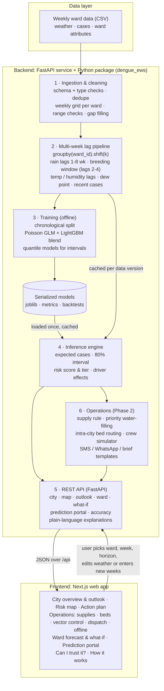

# 🦟 Dengue Early-Warning System

**Team CodeNova** · EDU AI Engineering Hackathon 2026 · Phase 1: *AI for Urban Dengue Outbreak* · Phase 2 (onsite
final): *operational resource optimization, intervention simulation and dispatch*

Forecasts dengue outbreak risk for each city ward **2–4 weeks ahead** from weekly rainfall, temperature and
humidity, and turns each forecast into an operational plan for ward commissioners and health-centre managers: how
many saline bags, test kits and hospital beds each ward needs, who gets scarce stock first, where overflow patients
go, where spraying crews prevent the most cases, and the SMS / WhatsApp / printed orders to send. Everything runs
offline.

    

---

## Contents

1. [The problem](#the-problem)
2. [What the system does](#what-the-system-does)
3. [System architecture](#system-architecture)
4. [Quick start](#quick-start)
5. [Using the web app](#using-the-web-app)
6. [Alerts and notifications](#alerts-and-notifications)
7. [Model and validation](#model-and-validation)
8. [Cost and resource efficiency](#cost-and-resource-efficiency)
9. [Project structure](#project-structure)
10. [Team](#team)
11. [AI assistance and external services](#ai-assistance-and-external-services)

---

## The problem

Dengue does not follow the same day's weather. Rain leaves standing water, *Aedes aegypti* eggs take 7–14 days to
become adult mosquitoes, and then viral incubation and symptom onset follow. The result is a **2–4 week lag**
between rain and hospital spikes. The same rain also hits wards differently: poor drainage, crowding and weak waste
collection turn some wards into hotspots much faster than their neighbours.

## What the system does

| Requirement | How we meet it |
|---|---|
| **Weather data processing** | Ingests `avg_temp_c`, `rainfall_mm` and `relative_humidity_pct`, then computes **1–8 week rainfall lags**, the **2–4 week breeding-window rainfall** and rolling totals, separately for each `ward_id` |
| **Risk prediction engine** | Trained models forecast expected cases for **+1 to +4 weeks** with an 80% range, a 0–100 risk score and a **Low / Medium / High / Critical** tier for any ward and week |
| **Cost efficiency** | Local inference on serialized models loaded once, precomputed and cached forecasts, no paid API or LLM calls |
| **User interface** | Next.js web app: city overview and 4-week outlook, **interactive risk map**, ward forecast with **main weather drivers**, what-if scenarios, a prediction portal for new data, and an accuracy report |

### Phase 2: operations command (`/ops` in the web app)

| Phase 2 requirement | How we meet it |
|---|---|
| **1 · Constrained resource allocation** | Forecast cases → `saline_bags_needed`, `diagnostic_kits_needed`, `hospital_beds_required` using the rule found in the onsite dataset (it reproduces all 31,320 rows exactly). An **Available regional stock slider (30–100%)**, optionally set per supply, and a **Total spraying crews** slider share out scarce stock by priority = 70% model risk score + 30% `population_density_sqkm` percentile (priority-weighted water-filling, whole units, deterministic). **Critical supply deficit** warnings update live. |
| **2 · Hospital surge & overflow routing** | Each ward's dengue bed capacity comes from its own history. Patients beyond capacity are moved, one at a time, to the least-loaded ward **of the same city** (Dhaka North, Dhaka South, Chattogram, Gazipur, Narayanganj). Shows net ward deficits, transfers, patients without a bed, and city-wide occupancy before and after routing, plus spare beds. |
| **3 · Vector-control simulator** | Deploy crews automatically (best return) or ward by ward. The **ML model is re-run** with each ward's breeding-habitat inputs reduced by the crews' coverage, giving counterfactual cases, beds and saline for **weeks 2–4**, with wards ranked by **cases prevented per crew**. |
| **4 · Multi-channel dispatch** | Ward notices as **SMS** (one 160-character GSM-7 segment in English; Bangla in UCS-2), **WhatsApp** and a **printable HTML/PDF commissioner brief**, in English or Bangla. Each lists predicted cases, allocated vs required supplies, deficit alerts, transfers and assigned crews. Samples are in [`exports/`](exports/). |
| **+ Smart early warning** | A notification bell and an **Alerts & Warnings** page. Alerts are raised automatically from the real forecasts: risk-level increases, sudden case increases, heavy rain combined with forecast risk, and wards heading for High or Critical within 4 weeks. Anonymous acknowledgement (New / Acknowledged / Resolved) per browser, and optional **browser push notifications** (Web Push, VAPID). See [Alerts and notifications](#alerts-and-notifications). |
| **5 · Offline resilience** | No LLM or external API anywhere; all messages come from fixed templates. The **Offline check** tab runs every module on the server with outbound network access switched off (`/api/ops/selftest`), and `tests/test_operations.py` does the same. |

---

## System architecture



### Components

| Layer | Component | Responsibility |
|---|---|---|
| Backend | `dengue_ews/data.py` | Validates and cleans raw weekly data, then aligns every ward to a complete Monday-weekly grid |
| Backend | `dengue_ews/features.py` | Ward-level multi-week weather lag pipeline; uses only data available on the forecast date |
| Backend | `train.py` | Trains one model per horizon, validates chronologically and serializes the models |
| Backend | `dengue_ews/model.py` | Loads the models once; returns predictions, intervals, risk tiers and driver breakdowns |
| Backend | `backend/main.py`, `backend/service.py` | FastAPI app: loads data and models once at startup, precomputes forecasts, serves the REST API |
| Backend | `backend/narrative.py` | Turns model output into plain-language headlines, reasons and suggested actions |
| Backend | `dengue_ews/operations.py` | Phase 2 arithmetic: supply rule, bed capacity, priority, water-filling allocation, crews needed, overflow routing, crew efficacy |
| Backend | `backend/planner.py` | Phase 2 service: constrained plan for a forecast week, model-driven vector-control simulator |
| Backend | `backend/dispatch.py` | SMS, WhatsApp and printable-brief templates in English and Bangla |
| Backend | `backend/offline.py` | Network kill-switch and the offline self-test |
| Backend | `backend/export_samples.py` | Writes the sample exports in `exports/` |
| Backend | `backend/alerts.py` | Alert detection rules, SQLite storage, per-browser statuses, background scan, replay command |
| Backend | `backend/push.py` | Web Push sending with VAPID keys from the environment; key generator |
| Frontend | `frontend/components/alerts/`, `frontend/app/alerts/`, `frontend/public/sw.js` | Notification bell, Alerts & Warnings page, service worker for push |
| Frontend | `frontend/` | Next.js 16 + React 19 + TypeScript + Tailwind; charts with Recharts, map with Leaflet |
| Frontend (alt.) | `app.py` | The original Streamlit dashboard, kept as a lightweight alternative |

### Request flow

1. The user picks a **ward**, a **forecast week** and an **early-warning window** (1–4 weeks) in the web app.
   The browser talks only to Next.js, which forwards `/api/*` requests to FastAPI.
2. The backend gets that ward's lag features (computed once at startup).
3. The models for the four horizons return expected cases, an 80% range and a tier.
4. **Drivers:** the ward is re-scored with each factor group (rainfall, temperature, humidity, recent cases, ward
   vulnerability) set to a typical value for that week of the year; the difference is shown as cases added or removed.
5. In **what-if** mode or the **prediction portal**, edited or new weather rebuilds the features for that single ward
   and re-scores it instantly.

Full design notes are in [ARCHITECTURE.md](ARCHITECTURE.md).

---

## Quick start

Requires **Python 3.11+**, **Node.js 20+** and git. Setup takes about 3–5 minutes.

```bash
git clone https://github.com/MLproject551/Hackathon_preli.git
cd Hackathon_preli
python -m venv .venv
# Windows:      .venv\Scripts\activate
# macOS/Linux:  source .venv/bin/activate
pip install -r requirements.txt
uvicorn backend.main:app --port 8000        # terminal 1: API (loads models once, ~15 s)
```

```bash
cd frontend && npm install && npm run dev    # terminal 2: web app
```

Open **http://localhost:3000**. The trained models are included in the repository, so no training step is needed.

The original Streamlit dashboard still works as a lightweight alternative: `streamlit run app.py` → http://localhost:8501.

| Optional command | Purpose |
|---|---|
| `python -m pytest -q` | Verifies the lag pipeline, guards against future-data leakage, checks inference, and tests the Phase 2 allocation, routing, simulator, dispatch and offline behaviour |
| `python -m backend.export_samples` | Regenerates the sample SMS / WhatsApp / brief exports in `exports/` (runs with the network switched off) |
| `python train.py` | Retrains and re-validates all models from the raw data (~10 min on a laptop CPU) |

**For live judging or any offline demo**, run the production build: `cd frontend && npm run build && npm start`.
The build downloads and bundles the web fonts once, so after that the app needs no internet at all. (`npm run dev`
also works offline, but it falls back to system fonts.)

---

## Using the web app

The **week slider** and the **"Warn me 1–4 weeks ahead"** switch at the top apply to every page.

| Page | What it shows |
|---|---|
| **City overview** | One-sentence summary, risk-level counts, a **4-week outlook per city**, ward cards ranked by risk, a week-by-week heatmap, CSV export |
| **Risk map** | Real OpenStreetMap map with every ward as a bubble coloured by risk (Critical wards pulse); hover, click, fly to a city, filter by level, **time-lapse** through the weeks. An **offline honeycomb view** works without internet |
| **Action plan** | Set how many field teams you have and get a ranked list of which wards each team should cover, with the suggested action; shows what changed since last week (new alerts, improvements, fastest risers); CSV and print |
| **Operations → Supplies & crews** | Stock (30–100%, optionally per supply), crews, planning basis (expected or likely-high) and area. Allocated vs required saline, kits and beds per ward in priority order, crew assignments, a live critical-deficit alert, CSV |
| **Operations → Hospital beds** | Bed pools per city (load before and after routing, moved, without a bed, spare), patient transfers and each ward's net bed balance |
| **Operations → Vector control** | Automatic or hand-picked crew deployment; model-driven cases, bed-weeks and saline prevented over weeks 2–4; ranking by cases prevented per crew; where the next crew helps most |
| **Operations → Dispatch** | SMS and WhatsApp notices per ward in English or Bangla, copy buttons, downloads, and the printable commissioner brief |
| **Operations → Offline check** | Browser and server status, and a one-click self-test that runs every module with the server's internet switched off |
| **Ward forecast** | Plain-language story, forecast cards for +1…+4 weeks, history and forecast chart, **driver breakdown**, weather with the breeding window, an action checklist, **what-if weather**, print / save as PDF |
| **Prediction portal** | The way to forecast **new weeks** beyond the dataset: enter the latest weeks of rainfall, temperature, humidity and cases for a ward (or upload a CSV, including rows copied straight from the official dataset), and get the next 4 weeks with the **saline, kits, beds and crews** they imply, a bed-capacity check, the **warnings** the alert rules would raise, and a CSV download |
| **Alerts & Warnings** (bell in the top bar) | Active alerts, critical warnings, high-risk warnings, weather-based warnings, sudden case increases and alert history, filtered by city, ward, risk level and date; acknowledge or resolve each alert; turn on browser notifications |
| **Can I trust it?** | Results on the unseen 2025 year in plain language, forecast-vs-actual chart for any ward, risk-level confusion matrix |
| **How it works** | The 2–4 week delay, the pipeline, the data split, the model, the architecture and the tech stack |

**Ward positions on the map are approximate:** the dataset has ward IDs but no boundaries or coordinates, so each
ward's bubble is placed inside a circle at its city corporation's real location.

**Prediction portal CSV columns:** `date, rainfall, temperature, humidity, cases` (one row per week; cases optional).

**Dataset columns** (`data/dengue_weekly.csv`, or an upload in the Streamlit app): `date, city, ward_id,
population_density_sqkm, water_logging_risk_index, sanitation_score, avg_temp_c, max_temp_c, min_temp_c, rainfall_mm,
relative_humidity_pct, dengue_cases`, plus the optional onsite columns `saline_bags_needed, diagnostic_kits_needed,
hospital_beds_required`. If those are missing, they are filled in from the per-case rule.

---

## Alerts and notifications

**How alerts are raised.** `backend/alerts.py` goes through the stored forecasts week by week and raises an alert when:

| Type | Rule (defaults; every value is configurable) |
|---|---|
| Risk rising | This week's 2-week forecast is a higher level than last week's 2-week forecast (Low → Medium → High → Critical) |
| Sudden case increase | The 2-week forecast is ≥ 50% **and** ≥ 3 cases a week above the ward's average reported cases over the last 4 weeks |
| Heavy-rain warning | The last 4 weeks' rain is above the ward's usual for that month (90th percentile, 2016–2023) or above 450 mm, is at least 100 mm, **and** the model forecasts Medium or worse within 2–4 weeks. Rain alone never raises an alert. |
| High risk ahead | A forecast within the next 4 weeks reaches High or Critical while this week's reported cases are below that level; the alert names the expected week |

**No repeats.** An alert fires when its condition *starts*, or when its level rises. The same ward and type then stay
quiet for 3 weeks unless the level rises further. Every alert has a unique key, so rescanning stores nothing twice, and
refreshing the dashboard never creates alerts: only the server's scanner does. It runs at startup, then every 15
minutes, and reloads the forecasts when `data/dengue_weekly.csv` changes.

**Storage.** SQLite (`data/alerts.sqlite3`, git-ignored; set `ALERTS_DB` to move it) with the tables `alerts`,
`alert_status` (status per alert per anonymous browser id, with acknowledged and resolved times),
`push_subscriptions` and `meta`. It needs no database server and is created automatically.

**Browser push.** Make a key pair once and put it in `.env` (git-ignored) or your host's environment settings:

```bash
python -m backend.push keygen      # prints VAPID_PUBLIC_KEY, VAPID_PRIVATE_KEY, VAPID_SUBJECT
```

Only the public key ever reaches the browser. Then click **Enable notifications** on the Alerts page. Push uses the
browser vendor's push service, so it needs the internet. Without keys or without internet, in-app alerts keep working.
Alerts found in the first scan of history are stored but never pushed. Only alerts raised by later scans (new data)
are pushed.

**Environment variables:** `VAPID_PUBLIC_KEY`, `VAPID_PRIVATE_KEY`, `VAPID_SUBJECT` (push), `ALERTS_DB` (optional), and
any threshold such as `ALERT_SURGE_PCT=80` or `ALERT_COOLDOWN_WEEKS=4`. See [`.env.example`](.env.example).

**Testing each alert type**

1. Open **Alerts & Warnings** (or the bell) and move the week slider to the 2025 monsoon (June to September).
   *Active alerts* lists every type; the tabs separate critical, high-risk, weather and sudden-increase alerts.
   Weather alerts appear in the wettest weeks (for example 2024 and 2025 monsoon peaks).
2. Acknowledge or resolve an alert, reload the page: the status persists for this browser. A different browser
   (or a private window) still sees it as New.
3. Push: click **Enable notifications**, then **Send a test**. You get the most urgent real alert of the week, marked [Test].
4. Replay new data arriving: `python -m backend.alerts replay 2025-08-01` forgets alerts raised from that week on.
   Then `curl -X POST localhost:8000/api/alerts/scan` (or wait for the background scan) raises them again as new and
   pushes them to every subscribed browser.
5. `python -m pytest -q tests/test_alerts.py tests/test_portal.py` checks each rule against the stored forecasts,
   the no-repeat logic, per-browser statuses, configurable thresholds and the push no-op without keys.

**Deployment.** Browsers allow push only on `https://` (or `localhost`). The backend needs a writable disk for SQLite,
the VAPID variables, and outbound internet for push services. Run a single backend process (the scanner lives in it),
or point several at one `ALERTS_DB` on shared disk.

---

## Model and validation

**Model:** one model per forecast horizon. Each blends a **Poisson GLM** (stable and interpretable) with
**LightGBM** using a Poisson objective (captures non-linear weather effects). The blend is made on the log scale,
with the weight tuned for each horizon. **LightGBM quantile models** provide the 80% prediction interval.

**Chronological validation:** the data is never shuffled.

| Split | Target weeks | Purpose |
|---|---|---|
| Train | 2016 – 2023 | Fit models |
| Validation | 2024 | Tune hyper-parameters and the blend weight |
| Test | 2025 | Final, one-time evaluation on unseen data |

**Results on the unseen 2025 test year:**

| Early-warning window | MAE | RMSE | R² | Baseline RMSE* | Tier accuracy | High/Critical alert recall |
|---|---|---|---|---|---|---|
| 1 week | 1.00 | 2.04 | 0.73 | 2.90 | 84% | 73% |
| 2 weeks | 1.05 | 2.18 | 0.69 | 3.43 | 84% | 69% |
| 3 weeks | 1.07 | 2.12 | 0.71 | 3.81 | 82% | 73% |
| 4 weeks | 1.30 | 2.28 | 0.67 | 4.00 | 82% | 76% |

\*Baseline = "cases stay the same as this week". The model reduces error by 30–44%.

**Risk tiers** (expected cases per ward per week, from historical percentiles):

| Tier | Expected cases | Suggested action |
|---|---|---|
| 🟢 Low | < 2 | Routine surveillance |
| 🟡 Medium | 2 – 7 | Inspect breeding sites, community awareness |
| 🟠 High | 7 – 13 | Larviciding and spraying, alert local clinics |
| 🔴 Critical | ≥ 13 | Emergency vector control, prepare hospital beds and test kits |

---

## Cost and resource efficiency

- **No paid APIs or LLM calls.** There are no per-request costs and no API keys. The only outside request is the
  street-map background (OpenStreetMap tiles); the offline map view and every forecast work without internet.
- **Serialized models** (joblib, ~8 MB) are loaded once per server.
- **Precompute and cache:** cleaning, lag features and forecasts for 2024–2025 run once at startup; the map data is
  built once per window and gzip-compressed (~160 KB). Most requests are lookups.
- **What-if scenarios** recompute a single ward rather than the whole city.
- **CPU only:** a what-if or portal prediction returns in about a second.

---

## Project structure

```
Hackathon_preli/
├── frontend/               # Frontend: Next.js web app
│   ├── app/                #   pages: overview, map, plan, ops/*, ward/[id], predict, accuracy, how-it-works
│   ├── components/         #   charts, map (street + offline), what-if, outlook, UI parts
│   └── lib/                #   API client and shared controls
├── backend/                # Backend: FastAPI service
│   ├── main.py             #   REST endpoints
│   ├── service.py          #   data + model service (loaded once)
│   ├── narrative.py        #   plain-language explanations and actions
│   ├── planner.py          #   Phase 2: allocation, bed routing, vector-control simulator
│   ├── dispatch.py         #   Phase 2: SMS / WhatsApp / printable brief templates (EN + BN)
│   ├── offline.py          #   Phase 2: network kill-switch and self-test
│   ├── export_samples.py   #   Phase 2: writes exports/
│   ├── alerts.py           #   early warning: detection rules, SQLite store, statuses, scan / replay
│   └── push.py             #   browser push (Web Push + VAPID)
├── app.py                  # Alternative frontend: Streamlit dashboard
├── train.py                # Training, validation, model export
├── dengue_ews/             # Backend: core package
│   ├── config.py           #   settings, schema, split dates, risk tiers
│   ├── data.py             #   ingestion and cleaning
│   ├── features.py         #   ward-level multi-week lag pipeline
│   ├── model.py            #   inference, risk tiers, driver contributions
│   └── operations.py       #   Phase 2 arithmetic (supplies, priority, water-filling, routing, crew efficacy)
├── models/                 # Serialized models, metrics, backtests
├── data/                   # Weekly ward dataset (onsite version with supply columns; 2016–2025, 60 wards)
├── exports/                # Sample SMS, WhatsApp and printable commissioner briefs
├── tests/                  # Pipeline, inference, what-if, translation and Phase 2 operations tests
├── experiments/            # Exploratory analysis scripts
├── requirements.txt
├── ARCHITECTURE.md
└── README.md
```

---

## Team

**CodeNova**

| Member | Role |
|---|---|
| *Hrittika Dutta* | *Backend* |
| *Atanu Dewanjee* | *Backend* |
| *Adrita Biswas* | *Frontend* |

---

## AI assistance and external services

As required by the hackathon rules:

| Tool | Usage |
|---|---|
| Claude Code (Anthropic) | AI coding assistant used for data analysis, pipeline and model code, the backend API, the web app, tests and documentation drafts. In Phase 2 it also helped derive the supply rule from the onsite dataset and write the allocation, routing, simulator, dispatch and offline modules, their tests and these documents. The team reviewed and tested all output. |
| *(add any other AI tools used)* | |

**External services used at runtime:** OpenStreetMap map tiles for the street-map background only. No paid APIs, no AI
services: Phase 2 dispatch notices come from fixed templates, not a language model.
**Open-source libraries:** pandas, NumPy, scikit-learn, LightGBM, joblib, FastAPI, Uvicorn, Pydantic, Next.js, React,
Tailwind CSS, Recharts, SWR, Leaflet, Streamlit, Plotly, pytest.
